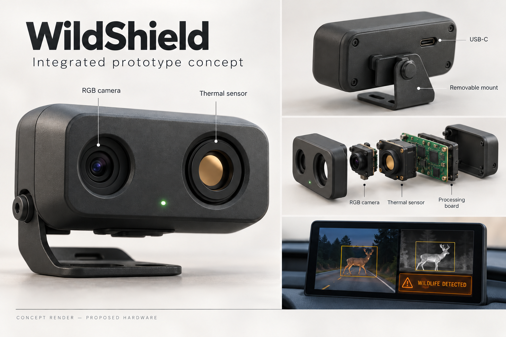

# WildShield

WildShield is a Python desktop application and educational prototype exploring wildlife-hazard detection near a model roadway. It combines RGB object recognition, MLX90640 thermal sensing, a two-panel dashboard, audio alerts, recorded trials, and local experiment logs. Range, approach speed, and SAFE/WARNING/DANGER states use simulated radar; they are not measured collision predictions.

It is not a vehicle safety system. Do not use it to make driving decisions or control a vehicle.

## Current capabilities

The program supports:

- A webcam (`--source 0`) or video/image file.
- YOLO detection with project labels: `deer`, `elephant`, `armadillo`, `dog`, `cow`, `person`, `cup`, `animal_model`, and `other`. The controlled `animal_model` label maps YOLO's `teddy bear` class to the stuffed-animal surrogate used in experiments.
- Optional YOLO-World open-vocabulary detection guided by class prompts such as `deer`.
- Bounding boxes, confidence, FPS, and timestamps.
- JSON Lines logs for later experiments.
- Combined RGB and thermal dashboard with same-cycle detection decisions.
- Live speaker alerts and fusion MP4 exports with generated alert audio.
- Optional annotated RGB video output (video only).
- Headless operation for prerecorded experiments.

## Setup

Python 3.12 is recommended.

```bash
uv sync --extra dev
```

Install [uv](https://docs.astral.sh/uv/getting-started/installation/) first. On macOS, allow camera access for the terminal/Python application when prompted. Connect the thermal hardware before running thermal or fusion commands.

The first real run downloads the small pretrained `yolo11n.pt` weights if they are not already cached.

## Run

Webcam with a display:

```bash
uv run python -m wildshield.main --source 0
```

For the first physical test, point the webcam at a coffee cup and filter the display to cups only:

```bash
uv run python -m wildshield.main --source 0 --classes cup --confidence 0.25 --alert
```

Move the cup around the frame, partly hide it, and vary the room lighting. A green `CUP` box should follow it, while detections are saved to `outputs/detections.jsonl`.

`--alert` prints an alert and sends the terminal bell when a matching object is detected. It alerts at most once every two seconds by default. Change that interval with `--alert-cooldown 5`. Terminal sound must be enabled to hear the bell; alert text always appears.

### Test deer detection with a still image

Supply your own appropriately licensed deer photo such as `deer1.jpg` in the project folder, then run YOLO-World on that image:

```bash
uv run python -m wildshield.main \
  --source deer1.jpg \
  --model yolov8s-world.pt \
  --world-classes deer \
  --no-display \
  --image-output outputs/deer1_annotated.jpg \
  --log outputs/deer1.jsonl
```

On the first run, Ultralytics downloads `yolov8s-world.pt` if it is not already cached. `--world-classes deer` initializes YOLO-World and calls `set_classes(["deer"])`; the regular `--classes` option remains a filter for WildShield's project labels. The annotated still image is written to `outputs/deer1_annotated.jpg`, and the detection data is saved in `outputs/deer1.jsonl`. Replace `deer1.jpg` with the path to your own local image.

For armadillo images, use `--world-classes armadillo --classes armadillo --confidence 0.05`. WildShield uses YOLO-World's `nine-banded armadillo` prompt for this label because the generic prompt did not detect the sample image; the lower confidence threshold is image-specific and may allow false positives.

For speaker audio without terminal alert messages on macOS, use:

```bash
uv run python -m wildshield.main --source 0 --classes cup --confidence 0.25 --alert-audio
```

macOS uses its built-in Ping sound. To select another audio file, add `--alert-sound /absolute/path/to/sound.wav`. On Raspberry Pi/Linux, install `aplay` or `paplay` and provide a WAV file with `--alert-sound`.

With `--alert-audio`, WildShield selects `animal_warning.aiff` for recognized animal detections (including YOLO-World prompts such as `elephant` and `armadillo`), selects `person_warning.aiff` for person detections, and falls back to the configured/default sound for other labels. A custom `--alert-sound` sets the fallback; existing category sounds take priority. Use the matching project label as the filter (for example, `--classes armadillo`) so the filter does not discard the detection before an alert is generated.

## No-hardware simulated radar demonstration

This mode tracks a detected cup and supplies a clearly labeled simulated range and approach speed to the risk engine:

```bash
uv run python -m wildshield.main \
  --source 0 \
  --classes cup \
  --confidence 0.25 \
  --simulate-radar \
  --sim-range 5 \
  --sim-speed 0.6 \
  --warning-range 3 \
  --danger-range 1 \
  --alert-audio \
  --danger-alert-only
```

Keep a cup visible. The simulated target starts at 5 m and approaches at 0.6 m/s, producing `SAFE`, `WARNING`, and `DANGER` states. The speaker sounds only at `DANGER`. The dashboard and logs explicitly mark the radar data as simulated; these values are not measurements from the camera.

Video file with saved annotations and logs:

```bash
uv run python -m wildshield.main \
  --source data/samples/night_test.mp4 \
  --output outputs/night_test_annotated.mp4 \
  --log outputs/night_test.jsonl
```

Headless experiment:

```bash
uv run python -m wildshield.main --source input.mp4 --no-display --log outputs/trial.jsonl
```

Useful options:

```text
--model yolo11n.pt       model name or local weights path
--confidence 0.40        minimum confidence
--device cpu             inference device (cpu, mps, 0, ...)
--classes person,deer    show only selected project labels
--max-frames 300         stop after a fixed number of frames
```

Press `q` or Escape to stop the display. Each JSONL record includes the source, frame number, timestamp, image size, inference time, and detections.

## Test

```bash
uv run pytest
```

## Thermal hardware check (MCP2221A + MLX90640)

Connect the MLX90640 to the MCP2221A with the STEMMA QT cable, then connect the MCP2221A to the Mac with a USB data cable. Install the optional dependencies:

```bash
uv sync --extra thermal --extra dev
```

Run the hardware check with MCP2221 mode enabled:

```bash
BLINKA_MCP2221=1 uv run python -m wildshield.sensors.thermal_check
```

A successful check finds I2C address `0x33`, reads all 768 temperatures in the 32 by 24 frame, and prints the minimum, center, and maximum temperatures.

## Live thermal heatmap

After the hardware check succeeds, open the live thermal viewer:

```bash
BLINKA_MCP2221=1 uv run python -m wildshield.sensors.thermal_view
```

The viewer enlarges the 32 by 24 sensor frame, applies an inferno color map, marks the hottest pixel, and shows the hottest, center, and display-range temperatures. Press `s` to save `outputs/thermal_snapshot.png`; press `q` or Escape to quit.

For a five-frame headless hardware test that saves the last frame:

```bash
BLINKA_MCP2221=1 uv run python -m wildshield.sensors.thermal_view --no-display --max-frames 5
```

The viewer also detects the largest connected warm region after it persists for two frames, draws a green `WARM TARGET` box, and logs detections plus raw temperatures to `outputs/thermal_detections.jsonl`.

Useful tuning options:

```text
--warm-threshold 3.0  degrees C above the estimated background
--min-hot-pixels 4    smallest connected region to accept
--persistence 2       consecutive frames required before confirmation
--no-log              disable the thermal JSONL log
```

Use the default 2 Hz with the MCP2221A. The 4 Hz mode may produce I2C retry failures on this USB bridge.

### Thermal + simulated radar danger demonstration

This thermal-only demonstration detects a warm region; it does not classify the object as an animal.

```bash
BLINKA_MCP2221=1 uv run python -m wildshield.sensors.thermal_view \
  --simulate-radar --sim-range 5 --sim-speed 0.6 \
  --warning-range 3 --danger-range 1 \
  --alert-audio
```

With `--alert-audio`, the thermal viewer plays the thermal warning as soon as a warm target is confirmed. The example enables radar simulation through `--simulate-radar`; omit that flag for thermal-only sensing. Audio in this thermal viewer is triggered by confirmed warmth, not risk-state transitions. Warm-target confirmation requires a region at least the configured threshold above the background, covering enough sensor pixels, for the configured number of consecutive frames.

## Combined RGB + thermal dashboard

For a controlled warmed stuffed-animal surrogate, use `animal_model`, which maps the pretrained model's `teddy bear` class. Aim both sensors at the same test area:

```bash
BLINKA_MCP2221=1 uv run wildshield-trial \
  --mode fusion \
  --trial-id animal-model-bright-present-NEW \
  --condition bright \
  --target-present \
  --distance-m 1 \
  --motion stationary \
  --source 0 \
  --model yolo11n.pt \
  --classes animal_model \
  --confidence 0.50 \
  --duration-seconds 10 \
  --warm-threshold 3.0 \
  --min-hot-pixels 4 \
  --persistence 2 \
  --alert-audio \
  --notes "Fixed mount; warmed stuffed-animal surrogate; room lights on"
```

Choose a new trial ID for every run to avoid overwriting results. Enter the actual lighting, measured distance, and motion. For a human test, use `--classes person` and describe the person in the notes. Model classification of a toy is not guaranteed.

Fusion trials save an MP4, final PNG, JSONL log, and summary JSON under `outputs/trials/`. With `--alert-audio`, ordinary detection audio requires RGB and thermal confirmation; simulated WARNING/DANGER transitions can sound on thermal evidence even if RGB misses. The trial timer starts after the first processed sensor/model frame, so startup may take longer than the requested duration.

Use `--mode thermal` for warm-region detection without RGB classification. Thermal sensing alone cannot identify species. RGB and thermal detections are combined temporally, not spatially calibrated; simultaneous detections do not establish a match in a multi-target scene.

The dashboard now uses adaptive fusion rule version 2. RGB plus thermal confirms an animal; thermal plus approaching radar produces a probable-animal warning; a single sensor without approaching radar produces a monitor state. Every JSONL row stores both the original raw `fusion_status` and the versioned `fusion_decision`. A decision based on prototype radar data is explicitly marked `radar_simulated: true` and must not be presented as measured radar performance.

Replay the accepted recorded experiments through the adaptive rule without changing the original evidence:

```bash
uv run python tools/replay_adaptive_fusion.py
```

The replay writes `outputs/competition/adaptive_fusion_replay.md` and `adaptive_fusion_replay.csv`. This is a retrospective software analysis, not a new physical experiment.

The standalone `wildshield-fusion` command defaults to `person,dog,cow,deer`; `wildshield-trial` defaults to `person`. Use `--classes person` explicitly for a person test. The default model still has no deer class.

## Unified controlled experiment command

Use `wildshield-trial` for official practice and experiment runs. It requires ground-truth metadata and produces a JSONL log, summary JSON, and (for thermal/fusion) final snapshot with the same trial ID.

```bash
BLINKA_MCP2221=1 uv run python -m wildshield.experiments.unified_trial \
  --mode fusion \
  --trial-id fusion-bright-present-01 \
  --condition bright \
  --target-present \
  --distance-m 3 \
  --motion stationary \
  --duration-seconds 10 \
  --alert-audio
```

For an empty trial, use `--target-absent --distance-m 0 --motion empty`. Valid modes are `rgb`, `thermal`, and `fusion`. The distance is physical ground truth entered by the operator; simulated radar values remain clearly separate.

For a one-image YOLO-World deer trial, place `deer1.jpg` in the project folder and run:

```bash
uv run python -m wildshield.experiments.unified_trial \
  --mode rgb \
  --trial-id deer_image_test \
  --condition bright \
  --target-present \
  --distance-m 1 \
  --motion stationary \
  --source deer1.jpg \
  --model yolov8s-world.pt \
  --world-classes deer \
  --classes deer \
  --confidence 0.50 \
  --duration-seconds 10 \
  --alert-audio \
  --image-output outputs/trials/testing_with_animal_images/deer_image_test_annotated.jpg \
  --no-display \
  --output-dir outputs/trials/testing_with_animal_images \
  --notes "Testing YOLO-World deer detection with a static image"
```

The still image is processed once, so `--duration-seconds` does not repeat inference for ten seconds. The trial's JSONL log, summary, and annotated image are saved under `outputs/trials/testing_with_animal_images`. `BLINKA_MCP2221=1` is not needed for an RGB-only trial.

## Known baseline limitation

The default pretrained COCO model recognizes person, dog, cow, and several other animals, but **does not contain a deer class**. Use the optional YOLO-World prompt mode described above to test for deer without changing the default model. YOLO-World can still miss deer depending on the image and confidence threshold; report this as a model limitation rather than treating a missed detection as proof that no deer is present.

## Planned product after build-out



This concept illustrates how WildShield is intended to look after build-out: an integrated enclosure containing the RGB camera and thermal sensor, with an adjustable mount and a connected warning dashboard. The current working prototype uses separate sensors connected to a laptop. The planned product could integrate into existing hardware or be offered as a separate hardware device. This rendering illustrates the proposed design; the enclosure, onboard processing, and dedicated display are future development. Image creation credit: OpenAI image generation, assisted by Codex. The dashboard imagery is illustrative and does not represent the resolution of the current 32×24 thermal sensor.

## Fusion risk-state audio

Enable `--alert-audio` to hear the fusion dashboard. On entry to simulated-radar `WARNING`, it plays `assets/sounds/risk_warning.aiff`; on entry to `DANGER`, it plays `assets/sounds/risk_danger.aiff`. These transitions can sound with thermal confirmation alone, even when RGB misses the target. Each state sounds once until the state changes; losing the target re-arms the alerts. Ordinary combined RGB/thermal detection sounds remain active outside warning/danger states. Radar-based risk remains simulated, not a measured collision prediction.

### Audio in saved fusion videos

With `--alert-audio`, fusion dashboard MP4s now embed the generated alert sounds after recording closes. Sounds align to the corresponding saved video frame; recordings use the configured video FPS rather than necessarily matching wall-clock timing. This is synthesized alert audio, not microphone/system-audio capture. A newer alert interrupts the preceding alert in the export. Without audio enabled, or without alert events, the saved MP4 remains silent.

To create a separate copy of an older recording with WARNING/DANGER sounds reconstructed from its matching JSONL log:

```bash
uv run python tools/add_recorded_risk_audio.py outputs/trials/YOUR_TRIAL_ID.mp4
```

The output ends in `_with_alerts.mp4`; an `.audio.json` sidecar documents reconstructed sounds. Originals are preserved. Radar-based risk remains simulated.

### Person and risk audio wording

RGB person detections use `person_warning.aiff` ("Person detected"). Simulated risk transitions use neutral `risk_warning.aiff` and `risk_danger.aiff` messages about a target, without claiming it is an animal. Thermal-only sensing cannot identify the species. Original uploaded sound files are preserved. Restart the application for this change; existing MP4 audio is unchanged.

## Evidence, analysis, and repository contents

Controlled person and warmed-model experiments are separate datasets. Wildlife still-image tests assess RGB recognition only. Adaptive fusion replay is retrospective software analysis using simulated radar, not additional physical trials. Random Forest analysis is a proposed improvement, not a currently deployed classifier.

Generated reports, trial videos, and logs are kept locally under `outputs/` and are not distributed in this repository. Reporting and demo scripts require the corresponding local evidence files. Wildlife sample images and model weights are also excluded; supply your own images and download the model weights as needed.

- `tools/build_overall_experiment_report.py`: inventory local trial summaries and link experiment groups.
- `tools/build_slide_charts.py`: create charts from existing local result tables.
- `tools/replay_adaptive_fusion.py`: evaluate revised rules on accepted recorded animal-model trials.
- `design/`: provisional OpenSCAD enclosure, engineering drawing, and handoff notes. Dimensions require component verification before fabrication.

Development used OpenAI Codex assistance for code, debugging, analysis, tests, documentation, and design artifacts; the product visualization used OpenAI image generation. Object recognition uses pretrained Ultralytics models. Student contributions and AI assistance should be described accurately in competition submissions.

### Slow startup in a cloud-synced folder

Keep Python environments outside OneDrive/iCloud to reduce file-provider delays. For example, on macOS:

```bash
export UV_PROJECT_ENVIRONMENT="$HOME/.cache/wildshield/venv"
uv sync --extra dev --extra thermal
BLINKA_MCP2221=1 PYTHONUNBUFFERED=1 uv run wildshield-trial --help
```

Keep that environment variable set in the terminal used for subsequent `uv run` commands. This changes the environment location, not the project or output directory. Camera/sensor initialization and first model loading can still take time.
